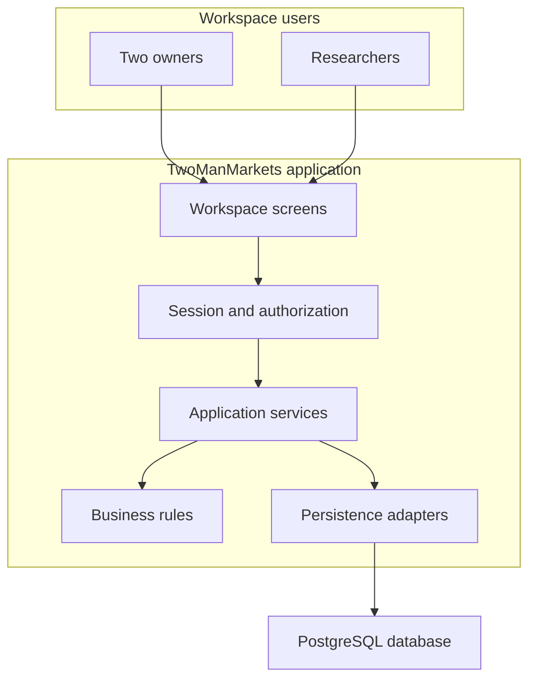
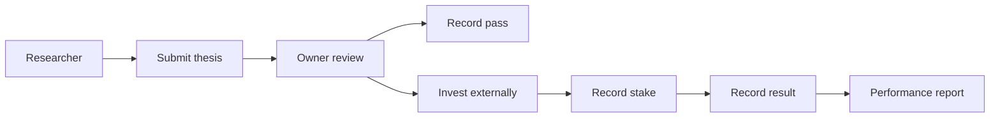
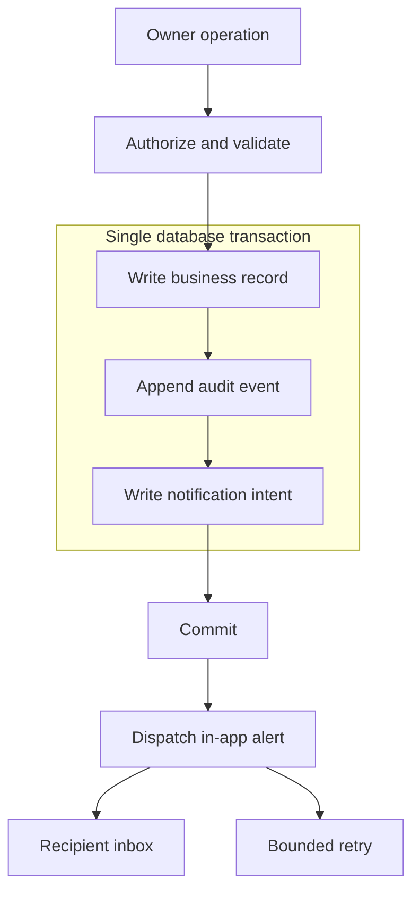

# TwoManMarkets — High-Level Design v0.1

**Document:** TMM-HLD-001 · **Date:** 8 November 2026  
**Status:** Proposed · **Target space:** myspace

## Overview

One internal workspace connects researcher recommendations, owner investment decisions, staff responsibilities and performance history.

> **Researchers recommend; owners decide and invest externally.**

The current delivery is a static UI shell with fictional records; this document describes the proposed future production system.

## Scope and Evidence

| Requirement | Evidence / status |
|---|---|
| Two owners; individual staff accounts and permissions | Client brief and master spec |
| Structured research and owner review | Client clarification recorded in master spec |
| Tasks, private/group chat and announcements | Client brief |
| ROI, win/loss and task productivity | Master spec; exact formulas need approval |
| In-app notifications only | Master spec |
| Current delivery has no backend functionality | Owner instruction in this chat |
| Production stack, USD and one investment per submission | Proposals; not client-approved decisions |

Evidence is the supplied brief/specification, not an independent verification with the client.

### In Scope

Invite-only identity, staff lifecycle, research review, recorded investments/results, assignments, membership-protected communication and scoped reporting.

### Out of Scope

Automated trading, custody, live market feeds, public signup, payroll, multi-organization tenancy and external notifications.

## Architecture

**H1 — Application boundary.** One deployable application; authorization runs on every server operation.

## Technology Stack

| Area | Proposal | Trade-off |
|---|---|---|
| Current preview | React, TypeScript, Vite | Fast static review; no production services |
| Production app | Next.js / TypeScript modular monolith | Shared deployments; simpler operations |
| Persistence | PostgreSQL through Prisma adapters | Relational integrity; backup/migration ownership |
| Business rules | Framework-independent TypeScript | Explicit domain logic; modest module structure |
| Alert delivery | Transactional outbox and dispatcher | Durable retries; backlog monitoring needed |
| Chat and alerts | Bounded polling initially | Lower complexity; delayed refresh |

The preview's client navigation is not an authentication or backend foundation.

## Domain Ownership

| Module | Authoritative records | Access |
|---|---|---|
| Identity / Team | Users, sessions, grants, profiles | Owners manage; staff see safe profiles |
| Research | Theses, decisions, investments, settlements | Staff submit; owners record capital/results |
| Tasks | Assignments and transition history | Owners assign; assignees update |
| Communication | Conversations, memberships, messages | Membership required |
| Notifications | Recipient inbox and delivery intent | Recipient-only reads |
| Analytics | Scoped projections of source records | Global owner / personal staff scope |
| Audit | Append-only security/business history | Owner-only reads |

## Core Architectural Concepts

### Research and Capital

**H2 — Research lifecycle.** The system records investment decisions; no application request places a trade.

| Principle | Consequence |
|---|---|
| Freeze research after investment | Later changes use an auditable correction |
| Exact decimals and currency | No floating-point ledger calculations |
| Retain financial/business history | Deactivation/anonymization replaces destructive cascades |
| Separate open capital from settled returns | Open positions do not inflate settled ROI |
| Canonical user identity | Research, tasks and communication reference one user |

### Transaction Integrity

**H3 — Durable intent.** Notification delivery cannot roll back a committed investment record.

## Security, Reliability and Deployment

| Concern | Proposed control |
|---|---|
| Login/session | Strong password hashes, opaque revocable sessions, no default owner credentials |
| Authorization | Active-account, capability and object/membership checks |
| Browser boundary | HTTPS, secure HTTP-only cookies, CSRF/origin checks, throttling |
| Data | Encrypted storage, managed secrets, least-privilege database access |
| Traceability | Request IDs, redacted structured logs, immutable audit events |
| Deployment | Separate development/staging/production secrets and databases |
| Schema release | Expand-and-contract migrations with staging verification |
| Recovery | Managed backups and observed restoration exercise |

Planning targets: 99.5% monthly availability, p95 normal reads below one second, RPO within 24 hours and RTO within four hours.

These targets require provider, workload and budget validation; they are not approved commitments.

## Development Phases

| Phase | Output | Done condition |
|---|---|---|
| 0 — Current shell | Seven sample-data sections | Client confirms terminology/workflow |
| 1 — Foundation | Accounts, sessions, permissions, audit | Staff cannot invoke owner operations |
| 2 — Operations | Research, recorded capital/results, tasks | Concurrency and financial tests pass |
| 3 — Communication | Chat membership, announcements, alerts | Unauthorized reads denied; retries deduplicate |
| 4 — Release | Historical reports and operating runbook | Formula acceptance, restore test, staging sign-off |

Each phase leaves contracts, migrations, test evidence and release notes; this design does not renew the earlier sprint estimate.

## Open Decisions

| ID | Proposed default / decision | Deciding owner | Impact |
|---|---|---|---|
| O1 | USD; one investment per submission | Business owners | Ledger and supported workflows |
| O2 | Staff research/channel/metric visibility | Business owners | Queries and permission tests |
| O3 | Retention, anonymization, correction authority | Business owners | History and deletion procedures |
| O4 | Owner recovery and reset delivery channel | Owners + engineering | Recovery implementation |
| O5 | Business timezone; propose `America/New_York` | Business owners | Report/DST boundaries |
| O6 | Provider, workload and operational targets | Owners + engineering | Hosting and load acceptance |

## LLD and Documentation Boundary

The LLD defines fields, contracts, validation, transactions, concurrency, errors and numbered implementation steps.

Formatting follows the supplied Zovu review rules and Venkat examples; their cloud, tenancy, email and loyalty decisions are not reused.

Use native editable Mermaid macros with default lavender styling; actual Confluence rendering remains unverified.

**Related:** [LLD](LOW_LEVEL_DESIGN.md), [Confluence handoff](CONFLUENCE_IMPORT.md), [ADR-001](adr/001-production-modular-monolith.md).
