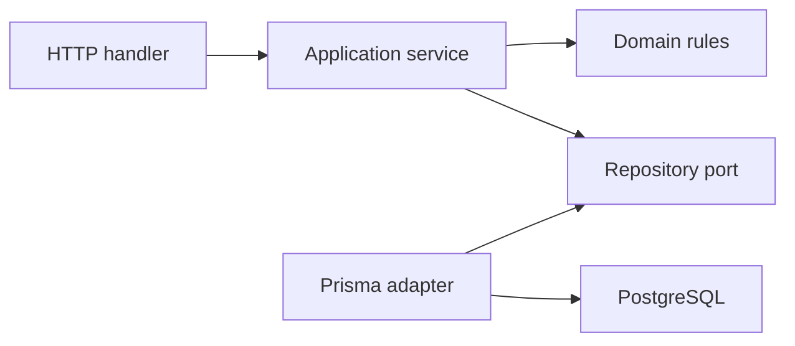
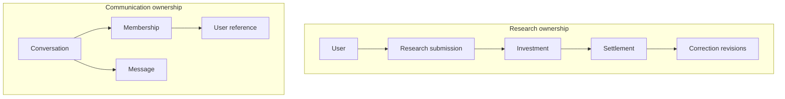
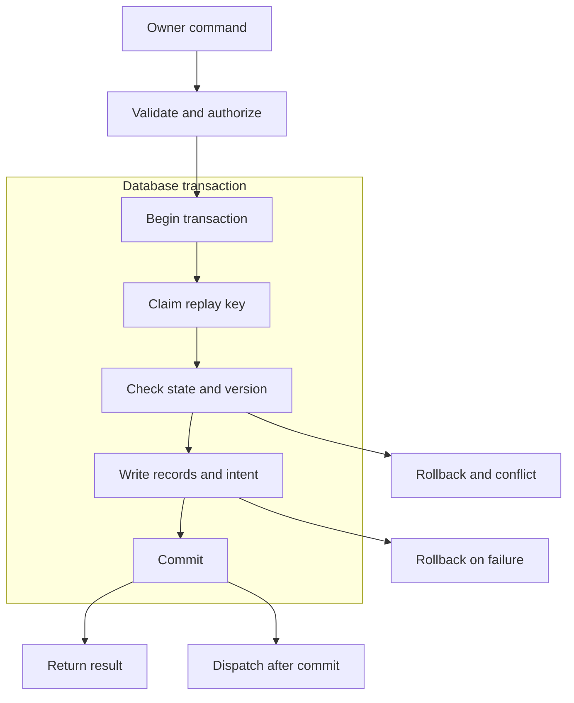
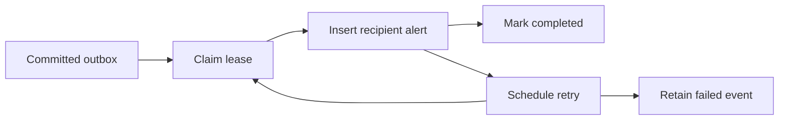

# TwoManMarkets — Low-Level Implementation v0.1

**Document:** TMM-LLD-001 · **Date:** 8 November 2026  
**Status:** Proposed · **Target space:** myspace

## Implementation Scope

Implement the future backend for the seven workspace areas; the static preview does not implement these contracts.

| Status | Scope |
|---|---|
| Required | Two owners, staff permissions, research review, tasks, chat, reports, in-app alerts |
| Proposed | Next.js/TypeScript, PostgreSQL, Prisma, transactional outbox, polling |
| Proposed | Single organization, USD, one investment and one final settlement per submission |
| Excluded | Trading integration, feeds, partial fills, public signup, external notifications |

## Architecture



**L1 — Dependency direction.** Domain rules never import framework, ORM or HTTP types.

## Module Structure

```text
src/app/                         HTTP adapters and pages
src/modules/identity/            Users, sessions, recovery
src/modules/team/                Profiles and capability grants
src/modules/research/            Thesis, decisions, capital history
src/modules/tasks/               Assignment and transitions
src/modules/communication/       Memberships, messages, announcements
src/modules/notifications/       Inbox and outbox dispatcher
src/modules/analytics/           Authorized historical queries
src/modules/audit/               Append-only business/security events
src/shared/domain/               UUID, Money, Clock, domain errors
src/shared/infrastructure/       Persistence, transaction runner, logs
```

| Component | Input | Output / responsibility |
|---|---|---|
| `SessionGuard` | Session cookie | Active actor or `401` |
| `AuthorizationPolicy` | Actor, capability, resource | Allow or deny |
| `ResearchService` | Actor and validated command | Submission, decision or ledger result |
| `TaskService` | Actor and versioned update | Task plus history |
| `ConversationService` | Actor, conversation, message | Membership-authorized message |
| `AnalyticsQuery` | Actor, interval, allowed filters | Scoped aggregates; no writes |
| `OutboxDispatcher` | Committed events | Deduplicated recipient alerts |

Use domain/application/ports/adapters for real business rules; simple CRUD can use a service and repository.

## Canonical Data Model

UUID identifiers; UTC `timestamptz`; mutable aggregates carry `version`; money uses `numeric(14,2)`.

| Entity | Fields and constraints | Indexes |
|---|---|---|
| `User` | Normalized unique username/email, password hash, name, `OWNER/STAFF`, active flag, session epoch, version | Username/email |
| `PermissionGrant` | User, capability, granting owner, time | Unique user/capability |
| `Session` | Token hash, user, epoch, expiry, `lastActivityAt`, revocation | Unique token hash; user/expiry |
| `PasswordReset` | Token hash, user, expiry, consumed time | Unique token hash |
| `Research` | Submitter, title, category, quoted odds text, suggested stake, currency, analysis, evidence URLs, status, version, times | Status/time/id; submitter/time/id |
| `ReviewDecision` | Research, owner, decision, reason, source version, time | Research/time/id |
| `Investment` | Unique research, owner, positive stake, USD, execution time/reference | Unique research; execution time/id |
| `Settlement` | Unique investment, original outcome/return, settled time, owner, `currentRevision=0` | Unique investment; settled time/id |
| `FinancialCorrection` | Settlement, revision, old/new values, reason, owner, time | Unique settlement/revision |
| `Task` | Title, description, creator, assignee, priority, status, deadline, completion time, `archivedAt`, version | Assignee/status/deadline/id |
| `TaskTransition` | Task, old/new status, assignee snapshot, actor, reason, time, resulting version; includes creation/reassignment/archive | Unique task/version; task/time/id |
| `Conversation` | `CHANNEL/DIRECT`, name, creator, stable DM participant-pair key, times | Unique DM pair |
| `Membership` | Conversation, user, joined/left times, last-read message | Unique conversation/user |
| `Message` | Conversation, sender, plain text, client message UUID, time | Unique sender/client UUID; conversation/time/id |
| `Announcement` | Owner, title, body, pinned flag, version, times | Time/id |
| `Notification` | Recipient, source event, kind, safe payload, resource, read time, created time | Unique recipient/event; recipient/read/time/id |
| `AuditEvent` | Retained actor reference, action, resource, request ID, redacted changes, time | Resource/time; actor/time |
| `OutboxEvent` | Type, aggregate, payload version, attempts, next attempt, lease expiry, completion/failure | Pending/next attempt |
| `IdempotencyRequest` | Actor, operation, key, request hash, stored result/status, expiry | Unique actor/operation/key |

Foreign keys retain authored history; account removal never cascades ledger records.



**L2 — Record boundaries.** Explicit memberships authorize conversations; financial records retain their own history.

## API Contracts

Prefix routes with `/api/v1`; a full OpenAPI specification is an output of the future foundation phase.

| Operation | Method / route | Input | Output |
|---|---|---|---|
| Login/logout | `POST /sessions`, `DELETE /sessions/current` | Credentials / cookie | Secure session / revocation |
| Staff | `GET/POST /staff`, `PATCH /staff/{id}` | Profile, permitted grants, version | Safe staff projection |
| Research | `GET/POST /research`, `GET/PATCH /research/{id}` | Thesis fields; version for edit | Scoped submission/list |
| Pass | `POST /research/{id}/decisions` | `PASSED`, reason, version, key | Decision and status |
| Invest | `POST /research/{id}/investment` | Stake, currency, execution time/reference, version, key | Recorded investment |
| Settle | `POST /investments/{id}/settlement` | Outcome, total return, settled time, version, key | Settlement |
| Correct | `POST /settlements/{id}/corrections` | Expected revision, new values, reason, key | Effective revision |
| Tasks | `GET/POST /tasks`, `PATCH /tasks/{id}` | Assignment, status, deadline, version | Task/history |
| Chat | Conversation, membership, message routes | Member identity, body, client UUID | Permitted page/message |
| Announcements/alerts | Publication and recipient inbox/read routes | Owner text / recipient target | Announcement / own alert |
| Reports/audit | `GET /analytics/*`, `GET /audit-events` | Interval and permitted filters | Scoped report / owner audit |

### Field Validation

| Boundary | Proposed validation |
|---|---|
| Title / analysis / message | Required trimmed text; max 200 / 20,000 / 4,000 characters |
| Category / status | Supported enum; reject unknown values |
| Quoted odds | Original text; no assumed external price conversion |
| Suggested stake / stake | Decimal strings; optional nonnegative / required positive; USD |
| Evidence URLs | HTTP/HTTPS only; no server fetching of submitted URLs |
| Identifiers / dates | UUID; valid UTC timestamp; bounded interval |
| Unknown fields | Reject; prevent mass assignment |
| Lists | Default 25, max 100; opaque `(createdAt,id)` keyset cursor |
| Mutations | Session, capability, resource, CSRF and origin checks |
| Important creates | `Idempotency-Key`; changed body with same key is `409` |
| Updates | Expected version; stale writes are `409` |

`requestId` traces a request; `Idempotency-Key` deduplicates a command. Correlation alone does not prevent duplicate writes.

```json
{"data":{"id":"uuid","status":"INVESTED","version":2},"meta":{"requestId":"uuid"}}
```

Lists add `meta.nextCursor`; errors use one envelope.

```json
{"error":{"code":"RESEARCH_VERSION_CONFLICT","message":"Refresh and retry.","requestId":"uuid"}}
```

| HTTP | Category | Behavior |
|---|---|---|
| `400` | Validation | Safe field errors; no writes |
| `401` | Invalid session | Reauthenticate; no private fields |
| `403/404` | Denied / not found | Deny or conceal inaccessible resources |
| `409` | Version/state/replay conflict | No partial writes |
| `429` | Rate limit | Retry after allowed delay |
| `503` | Dependency unavailable | Failed write; never claim success |

## Research Processing

| Function | Input and validation | Data changes / output |
|---|---|---|
| `submitResearch` | Active actor, valid thesis, key | Research + audit/outbox + replay result |
| `passResearch` | Owner, PendingReview, current version, reason/key | Decision + Passed + version + audit/outbox |
| `recordInvestment` | Owner, PendingReview, current version, positive stake/key | Unique investment + decision + Invested + audit/outbox |
| `recordSettlement` | Owner, unsettled investment, valid return/outcome/key | Unique settlement + effective outcome + audit/outbox |
| `correctSettlement` | Owner, current revision, corrected values, reason/key | Append revision + advance current revision + audit/outbox |

### Transaction Steps

```text
1. Validate input; resolve active actor and required capability.
2. BEGIN; claim actor/operation/idempotency key with request hash.
3. Return stored result on committed replay; reject changed body.
4. Lock aggregate; compare state and expected version/revision.
5. Enforce unique investment/settlement and financial constraints.
6. Write business record and aggregate version/status.
7. Append decision/history, audit and notification intent.
8. Store replay result; COMMIT; return success.
9. On pre-commit failure, ROLLBACK everything; return safe error.
```



**L3 — Investment transaction.** Replay protection, unique constraints and versions prevent duplicate or stale financial writes.

| State / rule | Behavior |
|---|---|
| `PENDING_REVIEW` | Submitter may edit with version check; owner passes or records investment |
| `PASSED` | Terminal initially; no reopening/edit without a future policy |
| `INVESTED` | Owner records Won, Lost or Push |
| `WON / LOST / PUSH` | Returned total is greater than / below / equal to stake; never negative |
| Correction | Lock settlement, append next revision, advance current revision atomically |

Reports use original settlement values at revision zero or the exact correction referenced by `currentRevision`.

Original values remain unchanged; effective research outcome derives from that revision; stale concurrent corrections return `409`.

## Tasks, Accounts and Communication

| Operation | Inputs / access | Data changes and failures |
|---|---|---|
| Task update | Owner or active assignee; version | Task + transition + audit/outbox together; reject stale update |
| Complete/reopen | Pending → In Progress → Completed; reason for reopening | Set/clear effective completion time; retain history |
| Reassign/archive | Owner and version | Record assignment/archive history; explicit reporting exclusion |
| Staff deactivation | Owner and target version | Disable, increment epoch, revoke sessions, append audit atomically |
| Owner removal | Serialized owner-membership check | Lock owner boundary; reject final-active-owner removal |
| Identity deletion | Owner; agreed retention | Anonymize retained references; no business-history cascade |
| Send message | Current membership, body, client UUID | Check membership with insert; deduplicate sender/client UUID |
| Read messages | Permitted membership | Scoped page; no private body on denial |
| Publish announcement | Owner and validated text | Announcement + audit/outbox together |

Channel visibility, pre-join message history and recovery delivery remain open decisions.

## Notification Processing



**L4 — Alert delivery.** Recipient/event uniqueness prevents duplicate alerts during replay.

```text
1. Claim due event with transaction and expiring lease.
2. Resolve permitted recipients using event and current policy.
3. Insert alerts with unique recipient/event keys.
4. Mark completed in the same delivery transaction; COMMIT.
5. On failure, ROLLBACK; increment attempts and schedule jittered backoff.
6. After five attempts, retain failed event for inspected replay.
7. Recover expired leases after worker crashes.
```

Proposed polling: every 15 seconds on visible pages with backoff; delivery failure never rolls back a business record.

No external integration exists initially; later calls need timeout, retry, idempotency, secrets and degradation policies.

## Analytics Contract

| Output | Formula / boundary |
|---|---|
| Settled profit | Sum effective returned total minus stake; filter by settlement timestamp |
| Settled ROI | Settled profit / settled stake × 100; open positions excluded |
| Win rate | Won / (Won + Lost) × 100; pushes excluded |
| Open capital | Stake without effective settlement, evaluated as of timestamp |
| Task completion | Completed eligible tasks / eligible assigned tasks × 100; proposed creation cohort |

Use decimals, display-only rounding, null for zero denominators and percentages recomputed from sums.

Convert business dates to UTC `[from,to)`; reconstruct task status/assignee as of interval end from transitions.

Staff queries apply access filters before aggregation; financial results belong to the original research submitter.

## Security and Operations

| Boundary | Proposed implementation |
|---|---|
| Passwords | Maintained calibrated hashing; no custom cryptography |
| Sessions | Hashed opaque tokens; secure HTTP-only cookies; rotate/revoke; active epoch checks |
| Expiry | Proposed 12-hour absolute / 30-minute idle; confirm with owners |
| Reset | Atomic single-use token and session revocation; delivery channel undecided |
| Login/reset | Account/network throttling and generic existence responses |
| Logs | Request ID, code, duration; no credentials, tokens or message bodies |
| Request budget | Proposed 10-second total with bounded database time; tune after load evidence |
| Database failure | Explicit write failure; no browser financial queue |

## Numbered Implementation Plan

```text
1. Identity, sessions, capabilities and audit.
   Done: owner-access and deactivation tests pass.
2. Research, exact-decimal ledger and task history.
   Done: duplicate funding, stale writes and financial tests pass.
3. Membership chat, announcements and notification intent.
   Done: denied reads and replay deduplication tests pass.
4. Historical analytics.
   Done: agreed formulas, empty denominators and DST cases pass.
5. Migration/restore rehearsal and staging acceptance.
   Done: observed operational evidence and runbook recorded.
```

Migration: expand → compatible deployment → bounded backfill → constraint validation → later contraction.

## Verification and Open Decisions

| Area | Required evidence |
|---|---|
| Domain | States, permissions, decimals, pushes, zero denominators |
| Database | Investment races, replay collisions, correction versions, rollback, retention |
| API | Object access, membership, CSRF, validation, field leakage |
| Operations | Worker recovery, restore, migrations, representative load |

| Decision | Proposed default / deciding owner | Impact |
|---|---|---|
| Ledger | USD, one investment; business owners | Schema and workflow |
| Reporting | Defined formulas/cohort; business owners | Report acceptance |
| Visibility | Least privilege; business owners | Channel/research/metric queries |
| Retention/recovery | Preserve history; owners + engineering | Account lifecycle |
| Provider/budgets | Validate before launch; owners + engineering | Hosting and load targets |

## Documentation Sources and Confluence

Content follows the project spec and client brief; proposed architecture is not represented as deployed code.

Formatting follows the supplied Zovu review rules, Notification Hub LLD and Loyalty HLD; module-specific decisions are not copied.

Use native grey code snippets, compact native tables and editable Mermaid macros with default lavender styling.

Markdown is import source; native formatting and diagram rendering must be verified in Confluence before publishing.

**Related:** [HLD](HIGH_LEVEL_DESIGN.md), [Confluence handoff](CONFLUENCE_IMPORT.md), [ADR-001](adr/001-production-modular-monolith.md).
